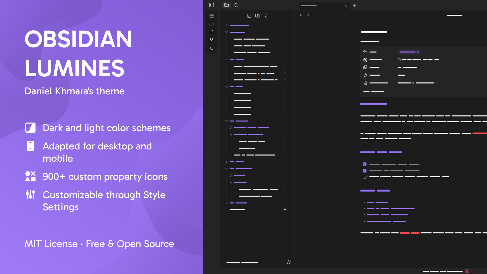
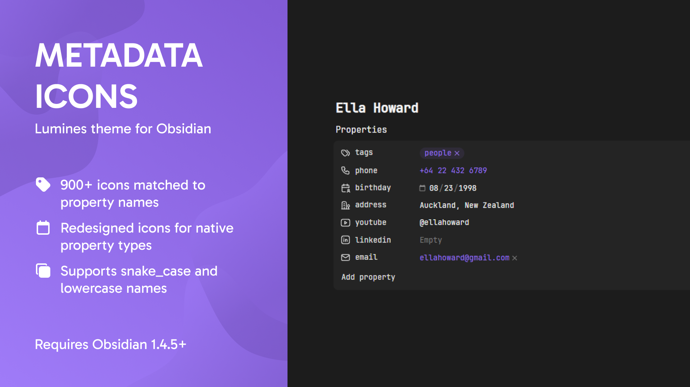
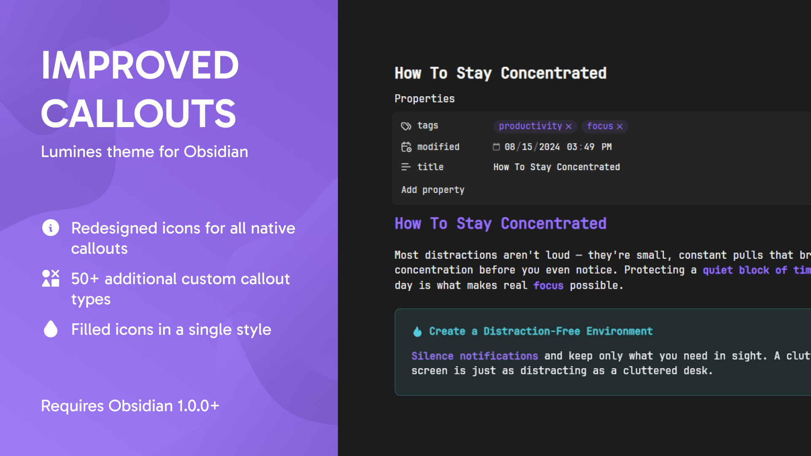
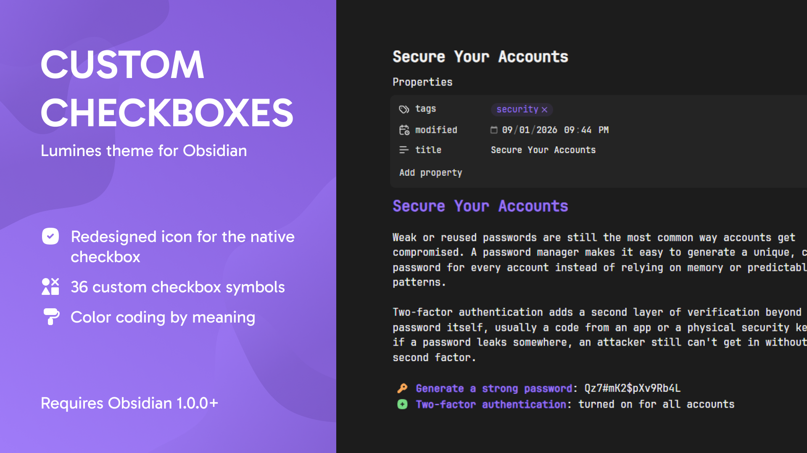
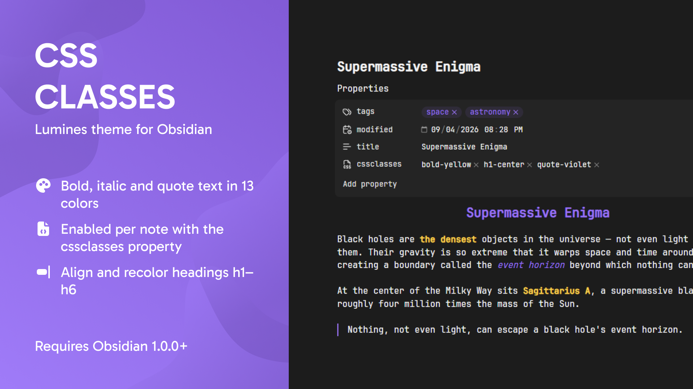
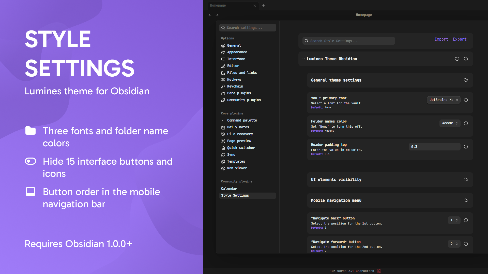

<h1 align="center">Obsidian Lumines</h1>

  <a href="https://github.com/danielkhmara/obsidian-lumines">Star me on GitHub</a> ⭐ <a href="https://github.com/danielkhmara/obsidian-lumines/issues">Report an issue</a>

  Obsidian Lumines has been in development since 2024 and is used by thousands of people. The theme refines the default look of Obsidian and keeps all interface elements in a single style. It works on Windows, macOS, iOS and Android and supports the Style Settings plugin for additional customization.

  Lumines is developed on <a href="https://obsidian.md/help/Catalyst+license">Obsidian Catalyst</a> early access builds. Each new build is tracked, so fixes and support for new features are prepared before the public release, and after an Obsidian update you usually do not have to wait for a theme update. The theme is free and open source under the MIT License.

<h2>Metadata Icons</h2>

  Metadata Icons make the Properties panel easy to read at a glance. The theme includes more than 900 icons from <a href="https://tabler.io/icons">Tabler Icons</a>, each matched to a property name.

  To show an icon, add a property to a note and give it a name from the <a href="metadata-icons.md">list of supported names</a>. Obsidian stores properties as YAML at the top of the file. The icon appears instantly and updates when the property is renamed.

  Properties outside the list still get an icon, chosen by type: text, list, number, checkbox, date or date with time. These native icons are redesigned too. This feature requires Obsidian 1.4.5 or newer.

<h2>Improved Callouts</h2>

  All native callouts and their aliases are available with redesigned filled icons. The theme also adds more than 50 custom callout types for objects and everyday notes, each with its own icon and color. A custom type is used the same way as a native one, for example <code>&gt; [!trophy]</code>.

  
Full list

   
  
Custom callout types. Native types are not included.

  

    <code>analyze</code> <code>archive</code> <code>award</code> <code>balloon</code> <code>ballpen</code> <code>bandage</code> <code>barbell</code> <code>bell</code> <code>bomb</code> <code>book</code> <code>bookmark</code> <code>calculator</code> <code>camera</code> <code>clock</code> <code>cloud</code> <code>confetti</code> <code>credit_card</code> <code>dashboard</code> <code>database</code> <code>device_gamepad</code> <code>diamond</code> <code>file</code> <code>file_analytics</code> <code>file_code_2</code> <code>file_info</code> <code>file_unknown</code> <code>filter</code> <code>flag</code> <code>flare</code> <code>folder</code> <code>gift_card</code> <code>headphones</code> <code>heart</code> <code>id</code> <code>key</code> <code>label</code> <code>leaf</code> <code>lock</code> <code>mail</code> <code>map_pin</code> <code>microphone</code> <code>paw</code> <code>phone</code> <code>pig</code> <code>pin</code> <code>puzzle</code> <code>radar</code> <code>receipt</code> <code>satellite</code> <code>scale</code> <code>school</code> <code>settings</code> <code>shield</code> <code>shopping_cart</code> <code>star</code> <code>tag</code> <code>thumb_down</code> <code>thumb_up</code> <code>ticket</code> <code>trash</code> <code>trophy</code> <code>user</code> <code>writing</code> <code>writing_sign</code>
  

<h2>Custom Checkboxes</h2>

  The native checkbox has a redesigned icon, and the theme adds 36 custom states. Each state has its own icon and a color that matches its meaning, so a task list is easy to scan.

  A checkbox is a list item with square brackets after the dash: <code>- [ ]</code>. Put a symbol inside the brackets to choose the state, for example <code>- [+]</code> or <code>- [!]</code>. Uppercase and lowercase symbols are different states.

  
Full list

   
  <table>
    <tr><th>Symbol</th><th>Icon</th><th>Color</th></tr>
    <tr><td><code>[0]</code></td><td><code>square-rounded-number-0</code></td><td>Violet</td></tr>
    <tr><td><code>[1]</code></td><td><code>square-rounded-number-1</code></td><td>Violet</td></tr>
    <tr><td><code>[2]</code></td><td><code>square-rounded-number-2</code></td><td>Violet</td></tr>
    <tr><td><code>[3]</code></td><td><code>square-rounded-number-3</code></td><td>Violet</td></tr>
    <tr><td><code>[4]</code></td><td><code>square-rounded-number-4</code></td><td>Violet</td></tr>
    <tr><td><code>[5]</code></td><td><code>square-rounded-number-5</code></td><td>Violet</td></tr>
    <tr><td><code>[6]</code></td><td><code>square-rounded-number-6</code></td><td>Violet</td></tr>
    <tr><td><code>[7]</code></td><td><code>square-rounded-number-7</code></td><td>Violet</td></tr>
    <tr><td><code>[8]</code></td><td><code>square-rounded-number-8</code></td><td>Violet</td></tr>
    <tr><td><code>[9]</code></td><td><code>square-rounded-number-9</code></td><td>Violet</td></tr>
    <tr><td><code>[+]</code></td><td><code>square-rounded-plus</code></td><td>Green</td></tr>
    <tr><td><code>[-]</code></td><td><code>square-rounded-minus</code></td><td>Red</td></tr>
    <tr><td><code>[!]</code></td><td><code>alert-square-rounded</code></td><td>Orange</td></tr>
    <tr><td><code>[?]</code></td><td><code>help-square-rounded</code></td><td>Orange</td></tr>
    <tr><td><code>[i]</code></td><td><code>info-square-rounded</code></td><td>Blue</td></tr>
    <tr><td><code>[u]</code></td><td><code>user</code></td><td>Sky</td></tr>
    <tr><td><code>[*]</code></td><td><code>star</code></td><td>Yellow</td></tr>
    <tr><td><code>[h]</code></td><td><code>heart</code></td><td>Pink</td></tr>
    <tr><td><code>[B]</code></td><td><code>bolt</code></td><td>Orange</td></tr>
    <tr><td><code>[b]</code></td><td><code>bulb</code></td><td>Yellow</td></tr>
    <tr><td><code>[U]</code></td><td><code>square-rounded-chevron-up</code></td><td>Violet</td></tr>
    <tr><td><code>[R]</code></td><td><code>square-rounded-chevron-right</code></td><td>Violet</td></tr>
    <tr><td><code>[D]</code></td><td><code>square-rounded-chevron-down</code></td><td>Violet</td></tr>
    <tr><td><code>[L]</code></td><td><code>square-rounded-chevron-left</code></td><td>Violet</td></tr>
    <tr><td><code>[l]</code></td><td><code>thumb-up</code></td><td>Violet</td></tr>
    <tr><td><code>[d]</code></td><td><code>thumb-down</code></td><td>Violet</td></tr>
    <tr><td><code>[f]</code></td><td><code>flame</code></td><td>Orange</td></tr>
    <tr><td><code>[k]</code></td><td><code>key</code></td><td>Orange</td></tr>
    <tr><td><code>[p]</code></td><td><code>point</code></td><td>Accent</td></tr>
    <tr><td><code>[P]</code></td><td><code>pin</code></td><td>Red</td></tr>
    <tr><td><code>[q]</code></td><td><code>quote</code></td><td>Gray</td></tr>
    <tr><td><code>[F]</code></td><td><code>flag-3</code></td><td>Red</td></tr>
    <tr><td><code>[A]</code></td><td><code>ad</code></td><td>Sky</td></tr>
    <tr><td><code>[I]</code></td><td><code>label-important</code></td><td>Orange</td></tr>
    <tr><td><code>[c]</code></td><td><code>confetti</code></td><td>Pink</td></tr>
    <tr><td><code>[C]</code></td><td><code>clock</code></td><td>Cyan</td></tr>
  </table>

<h2>CSS Classes</h2>

  Add classes to the <code>cssclasses</code> property of a note to change how that note looks. Bold text, italic text and the quote bar can be recolored in 13 colors, for example <code>bold-yellow</code>, <code>italic-blue</code> and <code>quote-violet</code>.

  Headings from h1 to h6 can be centered, aligned to the end or recolored, for example <code>h1-center</code>, <code>h6-end</code> and <code>h3-red</code>. Bold, italic and quote classes also have short forms that start with <code>b-</code>, <code>i-</code> and <code>q-</code>.

  
Full list

   
  <table>
    <tr><th>Class</th><th>Effect</th></tr>
    <tr><td><code>bold-{color}</code>, <code>b-{color}</code></td><td>Bold text color</td></tr>
    <tr><td><code>italic-{color}</code>, <code>i-{color}</code></td><td>Italic text color</td></tr>
    <tr><td><code>quote-{color}</code>, <code>q-{color}</code></td><td>Quote bar color</td></tr>
    <tr><td><code>h1-{color}</code> ... <code>h6-{color}</code></td><td>Heading color</td></tr>
    <tr><td><code>h1-center</code> ... <code>h6-center</code></td><td>Centered heading</td></tr>
    <tr><td><code>h1-end</code> ... <code>h6-end</code></td><td>Heading aligned to the end</td></tr>
  </table>
  

    Colors: <code>red</code> <code>orange</code> <code>yellow</code> <code>lime</code> <code>green</code> <code>cyan</code> <code>sky</code> <code>blue</code> <code>indigo</code> <code>violet</code> <code>pink</code> <code>gray</code> <code>white</code>
  

<h2>Style Settings</h2>

  The theme supports the <a href="https://github.com/mgmeyers/obsidian-style-settings">Style Settings</a> plugin. Once it is installed, the theme gets its own section in the plugin settings, where you can choose a font for the vault, recolor folder names, adjust header padding, hide interface buttons and change the order of buttons in the mobile navigation bar. Russian is supported, and all options are listed in the plugin itself.

<h2>How to Install</h2>

<ol>
  <li>Open <b>Settings</b>.</li>
  <li>Go to <b>Appearance</b>, then <b>Themes</b>, and select <b>Manage</b>.</li>
  <li>Select <b>Lumines</b> in the list of community themes.</li>
  <li>Select <b>Install and use</b>.</li>
</ol>

<h2>Feedback</h2>

  If you found a bug or have an idea, <a href="https://github.com/danielkhmara/obsidian-lumines/issues">open an issue</a>. If you want to improve the theme, send a <a href="https://github.com/danielkhmara/obsidian-lumines/pulls">pull request</a>.

